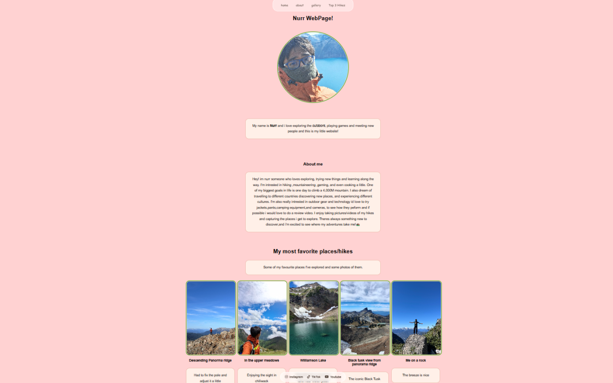
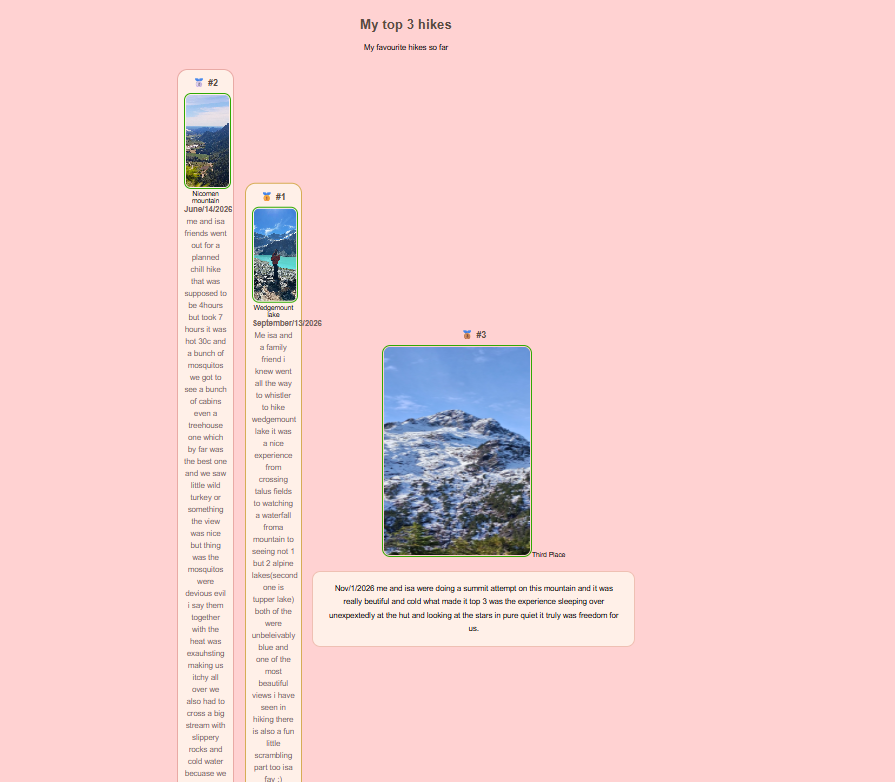

# My-website
my first website!
this is my firstt project and i just dumped all the ideas i had on it 
The main idea is a website about me or a little portfolio of my favourite things that i love to do. 
the reason why i made this project was to make a little portfolio for my ig profile :/  also so i can rank my fav hikes

the coding languages used are html and css

some problems were that my favicon wasnt working and i watched a bunch of tutorials also my navigation bar for redirects would have an underlined link that i wanted to remove i also had to clean up some of the alignments as they were off centerd another problem was it was just super zoomed out for my hike ranking it was just jumbled up with letters and messy around

 (img of zoomed out problem fixed by editing css and adding scrolling)

(img for my hike rankings fixed it by editing css and centering the images and resizing the image)

